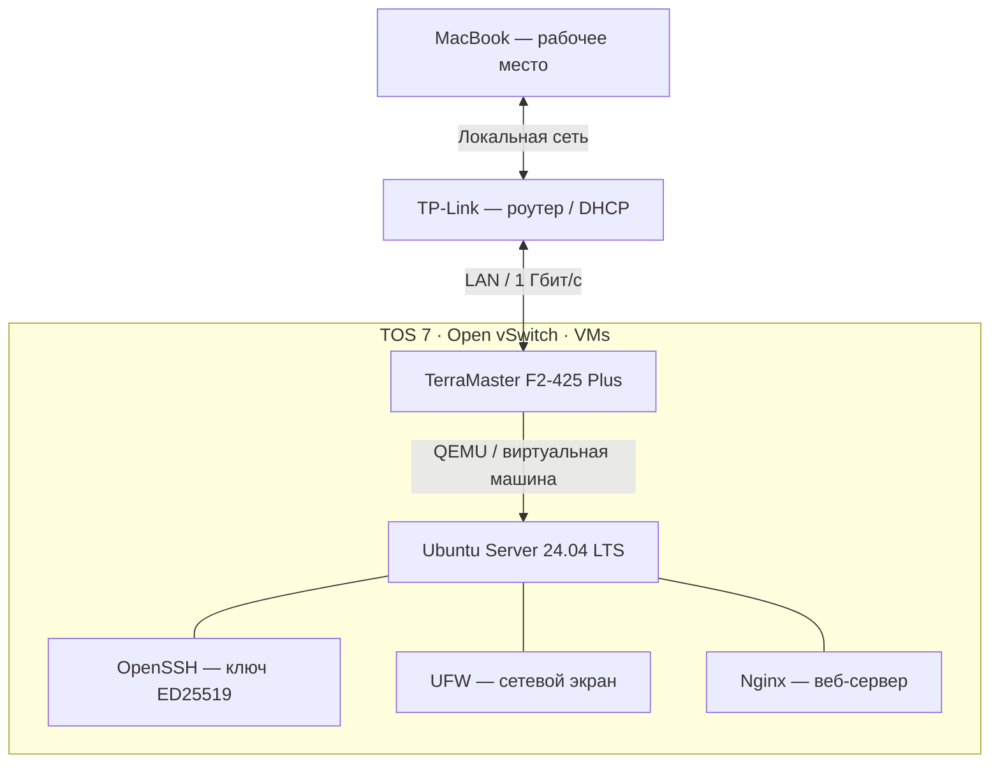

# Cybersecurity Home Lab

Практическая домашняя лаборатория по информационной безопасности.

## Цель проекта

Развёртывание собственной IT-инфраструктуры для изучения Linux, сетевых технологий, защиты серверов и мониторинга событий безопасности.

## Инфраструктура

- NAS: TerraMaster F2-425 Plus
- Виртуализация: TerraMaster VMs (QEMU)
- Операционная система: Ubuntu Server 24.04 LTS
- Веб-сервер: Nginx
- Удалённое администрирование: OpenSSH
- Брандмауэр: UFW

### Логическая схема инфраструктуры

*Схема отражает логическую архитектуру действующей домашней лаборатории. В дальнейшем будет заменена на схему из draw.io.*
  
## Выполненные работы

- [x] Развёрнута виртуальная машина Ubuntu Server
- [x] Настроено сетевое подключение
- [x] Настроен SSH-доступ по ключам ED25519
- [x] Отключена парольная авторизация SSH
- [x] Настроен UFW с ограничением входящих соединений
- [x] Установлен и протестирован Nginx
- [x] Создана первая HTML-страница

### Практические проекты

**01. Развёртывание и базовая защита Linux-сервера**

[📄 Открыть технический отчёт — Linux Server Deployment & Hardening](docs/01-linux-server-hardening.md)

Развёртывание Ubuntu Server на NAS TerraMaster, настройка SSH-аутентификации по ключам ED25519, ограничение сетевого доступа через UFW и публикация тестовой страницы Nginx.
  
## Следующие этапы

- [ ] Подготовить технические отчёты
- [ ] Добавить схемы инфраструктуры
- [ ] Настроить Git и публикацию сайта
- [ ] Развернуть систему мониторинга безопасности
- [ ] Выполнить практические сценарии анализа событий

## Автор

Evgeny Oleynikov — начинающий специалист по информационной безопасности.
  
